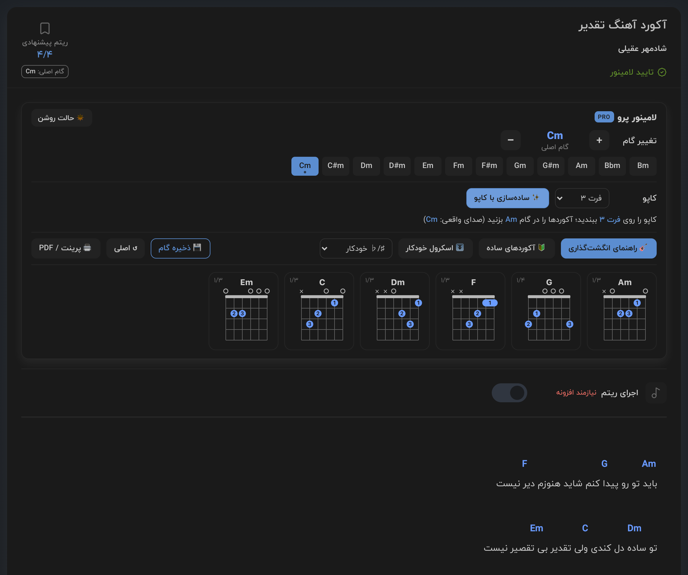

<div align="center">


# لامینور پرو · Laminor Pro

**افزونه‌ی رایگان و متن‌باز کروم و فایرفاکس برای صفحه‌های آکورد [laminor.org](https://laminor.org)**

تغییر گام · ساده‌سازی با کاپو · راهنمای انگشت‌گذاری · اسکرول خودکار · حالت تاریک · ذخیره‌ی گام · پرینت و PDF

[⬇️ دانلود آخرین نسخه](https://github.com/MahdiGraph/laminor-pro/releases/latest) · [راهنمای نصب](#نصب) · [English](#english)

</div>

<div dir="rtl">


> **نسخه‌ی ۱.۱:** سایت لامینور با طراحی جدید عوض شده و نسخه‌ی ۱.۰ روی اون کار نمی‌کنه. نسخه‌ی جدید با سایت تازه کار می‌کنه و اسکرول خودکار و حالت تاریک هم بهش اضافه شده. اگه نسخه‌ی قبلی رو دارید، [نسخه‌ی جدید](https://github.com/MahdiGraph/laminor-pro/releases/latest) رو نصب کنید ([راهنمای آپدیت](#آپدیت)).

## چی کار می‌کنه؟

بعد از نصب، توی صفحه‌ی هر آهنگ در لامینور، جای ابزارهای قفل‌شده‌ی خود سایت یه پنل ابزار ظاهر می‌شه. همه‌ی محاسبه‌ها توی خود مرورگر شما و روی همون آکوردهایی انجام می‌شه که سایت نمایش می‌ده؛ افزونه هیچ درخواستی به جایی نمی‌فرسته.

در نسخه‌ی جدید سایت، تغییر گام، راهنمای آکوردها، ساده‌سازی با کاپو، ذخیره‌ی گام، اسکرول خودکار و دانلود PDF برای کاربرهای بدون اشتراک فقط پنجره‌ی ورود یا خرید اشتراک رو باز می‌کنن. لامینور پرو نسخه‌ی رایگان و مستقل همین ابزارها رو می‌ده:

| قابلیت | وضعیت | توضیح |
|---|:---:|---|
| ساده‌سازی با کاپو | ✅ | بهترین فرت کاپو رو خودش حساب می‌کنه تا آکوردها به ساده‌ترین فرم‌های باز (Am، C، G، E، …) تبدیل بشن. برای همه‌ی آهنگ‌ها کار می‌کنه؛ فرت رو دستی هم می‌شه انتخاب کرد. |
| تغییر گام | ✅ | با دکمه‌های + و − یا انتخاب مستقیم گام. نت‌های عرضی بر اساس گام با دیز یا بمل نوشته می‌شن (یا هر کدوم که خودتون بخواید). آکوردهای اسلش‌دار (مثل D/F#) هم کامل جابه‌جا می‌شن. |
| ذخیره‌ی آکورد در گام موردنظر | ✅ | گام، کاپو و حالت ساده‌ی هر آهنگ ذخیره می‌شه و دفعه‌ی بعد خودکار اعمال می‌شه. لیست آهنگ‌های ذخیره‌شده توی پنجره‌ی افزونه هست. (ذخیره در مرورگر خودتون، نه حساب لامینور) |
| راهنمای انگشت‌گذاری | ✅ | دیاگرام همه‌ی آکوردهای آهنگ به ترتیب اجرا، با شماره‌ی انگشت، باره و سیم‌های باز/بسته. با کلیک روی هر دیاگرام حالت‌های دیگه‌ی همون آکورد رو می‌بینید و با بردن ماوس روی هر آکورد هم دیاگرامش نشون داده می‌شه. حالت چپ‌دست هم داره. |
| اسکرول خودکار | ✅ <sup>جدید</sup> | موقع نواختن، صفحه خودش آروم پایین می‌ره و آخر آهنگ می‌ایسته. سرعت رو از نوار پایین صفحه تنظیم کنید (یادش می‌مونه)؛ با دکمه‌ی توقف یا کلید Esc متوقف می‌شه. |
| حالت تاریک | ✅ <sup>جدید</sup> | همه‌ی صفحه‌های لامینور (نه فقط آکوردها) تیره می‌شن تا چشم رو اذیت نکنه. با دکمه‌ی «🌙 حالت تاریک» در پنل یا از پنجره‌ی افزونه: خاموش، روشن یا هماهنگ با حالت تاریک سیستم. عکس‌ها رنگ واقعی‌شون رو نگه می‌دارن و پرینت همیشه روشن می‌مونه. |
| پرینت آکوردها (PDF) | ✅ | نسخه‌ی تمیز آکورد با گام و کاپوی انتخابی و دیاگرام‌ها. برای فایل PDF در پنجره‌ی پرینت «Save as PDF» رو انتخاب کنید. |
| آکوردهای ساده | ✅ | آکوردهای پیچیده (مثل Cmaj7، Asus4، Bm7) رو به ساده‌ترین شکل قابل‌اجرا تبدیل می‌کنه؛ همراه ساده‌سازی با کاپو برای مبتدی‌ها خیلی کمک می‌کنه. |
| ویدیوهای اجرای ریتم و دوره‌ها | ❌ | محتوای ویدیویی روی سرور سایته و این افزونه کاری به اون نداره؛ دکمه‌ی «اجرای ریتم» سایت سر جاش می‌مونه. |

**یه مثال:** آهنگ «تقدیر» از شادمهر عقیلی در گام Cm با آکوردهای Ab، Bb، Cm، Gm، Eb و Fm نوشته شده که بیشترشون باره هستن. با «ساده‌سازی با کاپو» افزونه کاپو رو روی فرت ۳ می‌ذاره و همون آهنگ با F، G، Am، Em، C و Dm زده می‌شه.

<p align="center"></p>

## نصب

### کروم (و Edge، Brave، Opera و بقیه‌ی مرورگرهای کرومیومی)

1. فایل `laminor-pro-chrome-v1.1.0.zip` رو از [صفحه‌ی Releases](https://github.com/MahdiGraph/laminor-pro/releases/latest) دانلود کنید و از حالت فشرده خارج کنید.
2. توی نوار آدرس `chrome://extensions` رو باز کنید (در Edge‏ `edge://extensions` و در Brave‏ `brave://extensions`).
3. گزینه‌ی **Developer mode** رو در گوشه‌ی صفحه روشن کنید.
4. روی **Load unpacked** کلیک کنید و پوشه‌ای که از zip درآوردید رو انتخاب کنید (پوشه‌ای که فایل `manifest.json` داخلشه).
5. یه صفحه‌ی آکورد لامینور رو باز کنید (اگه از قبل بازه، رفرشش کنید). پنل «لامینور پرو» بالای آکوردها ظاهر می‌شه.

> بعد از نصب، پوشه رو پاک نکنید؛ کروم افزونه رو از همون‌جا اجرا می‌کنه.
>
> راه دیگه: از دکمه‌ی سبز **Code ← Download ZIP** کل مخزن رو بگیرید و در مرحله‌ی ۴ پوشه‌ی `extension` رو انتخاب کنید.

### فایرفاکس

**نصب موقت (همه‌ی نسخه‌های فایرفاکس):**

1. فایل `laminor-pro-firefox-v1.1.0.xpi` رو از [صفحه‌ی Releases](https://github.com/MahdiGraph/laminor-pro/releases/latest) دانلود کنید.
2. آدرس `about:debugging#/runtime/this-firefox` رو باز کنید.
3. روی **Load Temporary Add-on…** کلیک کنید و فایل xpi رو انتخاب کنید (یا فایل `manifest.json` داخل پوشه‌ی `extension`).
4. صفحه‌ی آکورد لامینور رو باز یا رفرش کنید.

> افزونه‌ی موقت با بستن فایرفاکس حذف می‌شه و دفعه‌ی بعد باید دوباره بارگذاری بشه.

**نصب دائمی:** فایرفاکس معمولی فقط افزونه‌هایی رو دائمی نصب می‌کنه که موزیلا امضاشون کرده باشه. دو راه دارید:

- با [Firefox Developer Edition](https://www.mozilla.org/firefox/developer/)، Nightly یا ESR: در `about:config` مقدار `xpinstall.signatures.required` رو `false` کنید، بعد در `about:addons` از منوی ⚙️ گزینه‌ی **Install Add-on From File…** رو بزنید و فایل xpi رو انتخاب کنید.
- امضای رایگان یه نسخه‌ی شخصی در [addons.mozilla.org](https://addons.mozilla.org/developers/) (گزینه‌ی «On your own») و نصب فایل امضاشده.

> اگه پنل نمایش داده نشد: روی آیکون افزونه‌ها (🧩) در نوار ابزار کلیک کنید و برای Laminor Pro دسترسی به laminor.org رو فعال کنید («Always allow on laminor.org»).

### آپدیت

- **کروم:** فایل‌های نسخه‌ی جدید رو **توی همون پوشه‌ی قبلی** جایگزین کنید و در `chrome://extensions` دکمه‌ی ↻ افزونه رو بزنید، بعد صفحه‌های لامینور رو رفرش کنید. (اگه پوشه رو عوض کنید، کروم اون رو یه افزونه‌ی تازه می‌بینه و گام‌های ذخیره‌شده از دست می‌رن.)
- **فایرفاکس:** فایل xpi جدید رو مثل بالا نصب کنید.

## استفاده

- **تغییر گام:** با + و − نیم‌پرده‌به‌نیم‌پرده جابه‌جا کنید یا مستقیم روی گام دلخواه بزنید. نقطه‌ی زیر یکی از گام‌ها یعنی گام اصلی آهنگ.
- **کاپو:** فرت رو از لیست انتخاب کنید یا «✨ ساده‌سازی با کاپو» رو بزنید تا افزونه ساده‌ترین حالت رو پیدا کنه. زیرش نوشته می‌شه کاپو رو کجا ببندید و آکوردها رو در چه گامی بزنید.
- **آکوردهای ساده:** آکوردهای پیچیده رو به آکوردهای سه‌صدایی ساده (یا هفتمِ ساده‌تر، مثل B7 به‌جای B) تبدیل می‌کنه.
- **راهنمای انگشت‌گذاری:** دیاگرام‌ها به ترتیب اجرای آهنگ نمایش داده می‌شن؛ روی هر دیاگرام کلیک کنید تا حالت بعدی همون آکورد بیاد.
- **اسکرول خودکار:** «⏬ اسکرول خودکار» رو بزنید؛ صفحه از اول آکوردها شروع به پایین رفتن می‌کنه. با − و + یا نوار لغزنده‌ی پایین صفحه سرعت رو عوض کنید و با ⏸ یا Esc متوقفش کنید.
- **حالت تاریک:** دکمه‌ی «🌙 حالت تاریک» بالای پنل همه‌ی صفحه‌های لامینور رو تیره می‌کنه (و «☀️ حالت روشن» برش می‌گردونه). توی پنجره‌ی افزونه می‌تونید «هماهنگ با سیستم» رو هم انتخاب کنید تا هر وقت گوشی یا کامپیوترتون تیره‌ست، لامینور هم تیره باشه.
- **ذخیره گام:** تنظیمات فعلی رو برای این آهنگ نگه می‌داره. «حذف ذخیره» و دکمه‌ی «اصلی» همه‌چیز رو برمی‌گردونه.
- **پرینت / PDF:** توی پنل، کنار دکمه‌ی دانلود PDF خود سایت و در منوی ⚙️ نسخه‌ی موبایل هست. Ctrl+P (یا ⌘+P) هم آکوردها رو با گام و کاپوی انتخابی چاپ می‌کنه.
- **تنظیمات کلی:** روی آیکون افزونه در نوار ابزار کلیک کنید: حالت تاریک، نمایش پیش‌فرض دیاگرام‌ها، ساده‌سازی پیش‌فرض با کاپو، نوشتن نت‌ها با دیز یا بمل، دیاگرام چپ‌دست، پنهان‌کردن دکمه‌های قفل‌شده‌ی خود سایت و لیست آهنگ‌های ذخیره‌شده.

## حریم خصوصی

- افزونه هیچ داده‌ای جمع‌آوری نمی‌کنه و هیچ درخواست شبکه‌ای نمی‌فرسته.
- تنظیمات و گام‌های ذخیره‌شده فقط در حافظه‌ی افزونه در مرورگر خودتون می‌مونه.
- دسترسی‌ها فقط `storage` و صفحه‌های laminor.org هستن.

## یادداشت

- این پروژه غیررسمیه و ارتباطی با تیم لامینور نداره.
- افزونه به سیستم اشتراک سایت دست نمی‌زنه و محتوای قفل‌شده‌ای رو باز نمی‌کنه: همه‌ی ابزارها مستقل و از نو نوشته شدن و روی آکوردهایی کار می‌کنن که سایت به همه نشون می‌ده. محتوایی که سایت فقط به مشترک‌ها می‌ده (ویدیوهای اجرای ریتم، دوره‌ها) دست‌نخورده می‌مونه.
- اگه مشترک لامینور هستید و ابزارهای خود سایت رو می‌خواید، تیک «پنهان‌کردن دکمه‌های قفل‌شده‌ی خود سایت» رو در پنجره‌ی افزونه بردارید.
- آکوردها و متن ترانه‌ها متعلق به صاحبانشون و لامینور هستن. اگه از لامینور استفاده می‌کنید، [اشتراک](https://laminor.org/pricing) به ادامه‌ی کار سایت کمک می‌کنه.
- باگ یا پیشنهاد؟ [یه Issue بسازید](https://github.com/MahdiGraph/laminor-pro/issues).

</div>

<p align="center"></p>

---

## English

**Laminor Pro** is a free, open-source browser extension (Chrome, Edge, Brave, Opera and Firefox) that adds player tools to the chord pages of [laminor.org](https://laminor.org), a Persian guitar-chord site. Version 1.1 works with the site's November 2026 redesign, where these tools only open a sign-in/subscription prompt for non-subscribers:

- **Capo simplification** — finds the capo fret that turns a song into the easiest open-chord shapes (e.g. *Taghdir* in C minor, `Ab Bb Cm Gm Eb Fm`, becomes `F G Am Em C Dm` with capo 3).
- **Transpose** — semitone steps or direct key selection, with key-aware sharp/flat spelling (slash-chord bass notes move too).
- **Saved keys** — key, capo and options are remembered per song (stored locally in the browser) and listed in the toolbar popup.
- **Fingering guide** — chord diagrams with fingers, barres and open/muted strings, alternative voicings, hover diagrams and a left-handed mode.
- **Auto-scroll** *(new)* — scrolls the sheet at an adjustable speed and stops at the end; Esc stops it.
- **Dark mode** *(new)* — darkens every laminor.org page (the site itself is light only): on, off or following the system setting. Photos keep their colours and printing stays light.
- **Print / PDF** — a clean print layout with the chosen key, capo and diagrams; Ctrl+P prints the chosen key too.
- **Simple chords** — reduces extended chords to easy triads (or easier sevenths such as B7).

Laminor's rhythm videos and courses are left untouched. Everything else is computed locally from the chords the page already shows; the extension makes no network requests and collects no data. Not affiliated with Laminor.

### Install

- **Chrome / Chromium browsers:** download `laminor-pro-chrome-v*.zip` from [Releases](https://github.com/MahdiGraph/laminor-pro/releases/latest) and unzip it → open `chrome://extensions` → enable **Developer mode** → **Load unpacked** → pick the unzipped folder. To update, replace the files in the same folder and press ↻ (a new folder means a new extension id, and saved keys stay with the old one).
- **Firefox (temporary):** download `laminor-pro-firefox-v*.xpi` → `about:debugging#/runtime/this-firefox` → **Load Temporary Add-on…** → pick the file. For a permanent install use Developer Edition/Nightly/ESR with `xpinstall.signatures.required = false`, or self-sign it on [AMO](https://addons.mozilla.org/developers/).

### Development

```
extension/
  manifest.json      Manifest V3, works in Chrome and Firefox
  src/core/          music logic without DOM: chord parsing, transposition,
                     chord shapes + difficulty, capo search, sheet parser
  src/content/       site.js — every laminor.org selector (the file to change
                       when the site's markup changes)
                     theme.js/.css — dark mode, injected at document_start
                     main.js — finds sheets as they appear (the site is a
                       Next.js single-page app), mounts the tools per song
                     panel, sheet copy, SVG diagrams, auto-scroll, print
  src/popup/         toolbar popup (options + saved songs)
  src/shared/        storage wrapper (chrome.* / browser.*)
tests/
  core.test.js       unit tests, incl. a check that every chord shape plays
                     exactly the notes of its chord
  e2e/chromium.js    smoke test against the live site (layout, tools,
                     navigation without page loads, print, popup)
scripts/build.mjs    builds dist/*.zip (Chrome) and dist/*.xpi (Firefox)
```

```bash
npm test                 # unit tests (Node 20+)
npm run lint             # Mozilla web-ext lint
npm run build            # installable archives in dist/
npm install && npx playwright-core install chromium && npm run test:e2e
```

The site's sheet is hidden and replaced by a deep clone of it in which each chord sits in a slot that keeps the original chord's width, so transposed chords never shift the alignment with the lyrics. The extension waits until React has hydrated the page before touching it, and Next.js keeps visited songs in the DOM (hidden) for the Back button, so each song keeps its own panel and choices. To release, bump `version` in `extension/manifest.json` and `package.json`, then publish a GitHub release — the workflow attaches the archives.

License: [MIT](LICENSE)
